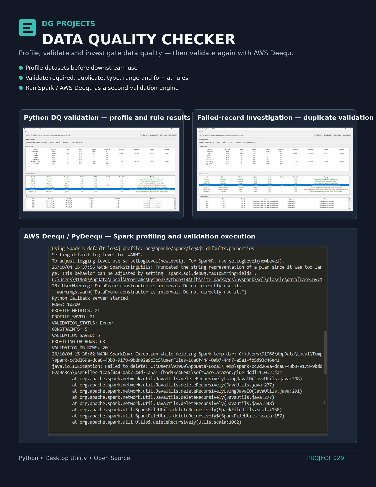
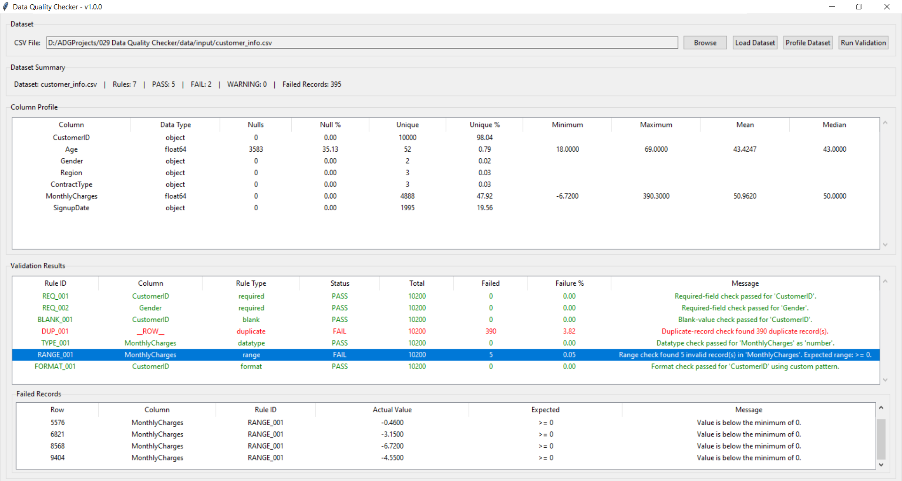
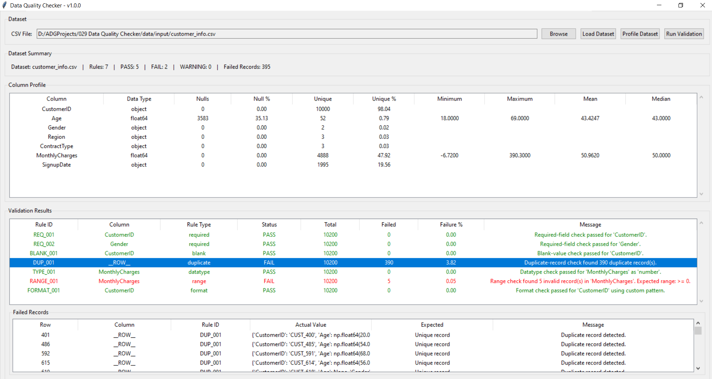
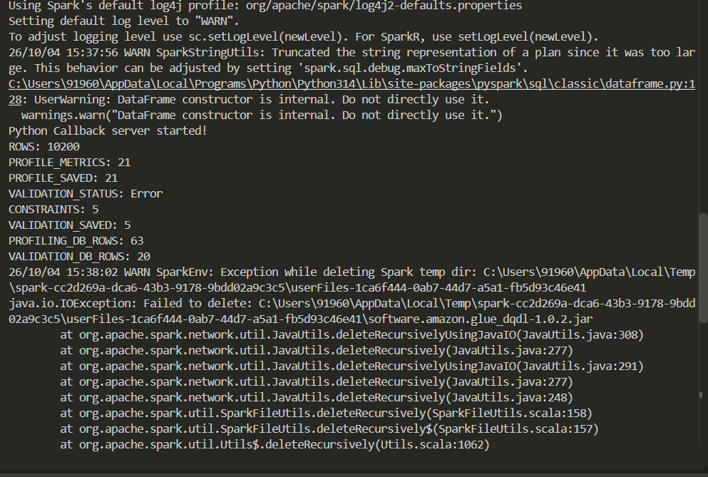

---

# 2. Project Badges


---

# 3. Screenshots

### Main Application — Profile and Validation Results



### Failed-Record Investigation — Duplicate Validation



### AWS Deequ / PyDeequ — Spark Profiling and Validation



---

# 4. Project Title

# Data Quality Checker

---

# 5. Project Overview

Data Quality Checker is a Python desktop application for profiling datasets and identifying data-quality problems before the data is used by downstream systems.

The project addresses a common data-engineering problem: a dataset may appear structurally valid while still containing duplicate records, invalid values, missing fields, datatype issues, formatting problems, or values outside expected ranges.

The application provides two complementary approaches:

- **Python-based data quality validation** using configurable validation rules.
- **AWS Deequ / PyDeequ validation** using Spark-based analyzers and constraints.

### Typical Use Cases

- Profile a CSV dataset before downstream processing.
- Identify duplicate, blank, missing, invalid, or out-of-range records.
- Apply configurable data-quality rules.
- Review failed records and validation results.
- Calculate dataset and column-level quality scores.
- Maintain validation and quality history in SQLite.
- Independently profile and validate the same dataset using AWS Deequ / PyDeequ.

---

# 6. Features

- CSV dataset loading and profiling.
- Column-level statistics including datatype, nulls, uniqueness, minimum, maximum, mean, and median where applicable.
- Required-field validation.
- Blank-value validation.
- Duplicate-record validation.
- Datatype validation.
- Range validation.
- Format and regular-expression validation.
- Business-rule validation framework.
- Configurable validation rules using JSON.
- PASS / WARNING / FAIL validation outcomes.
- Failed-record identification with actual and expected values.
- SQLite persistence for dataset, validation, and quality results.
- Overall quality scoring.
- Column-level and category-level quality assessment.
- Validation/load history.
- Quality comparison support.
- Schema comparison support.
- AWS Deequ / PyDeequ Spark-based profiling.
- AWS Deequ / PyDeequ constraint validation.
- Separate persistence of Deequ profiling and validation results.
- Desktop GUI built with Tkinter.

---

# 7. Technology Stack

| **Technology** | **Purpose** |
| -------------- | ----------- |
| Python 3.14 | Application development |
| Tkinter | Desktop graphical user interface |
| pandas | Dataset loading, profiling, and Python-based data-quality processing |
| NumPy | Numeric data handling and validation calculations |
| PySpark 4.1.1 | Spark execution layer for Deequ |
| PyDeequ 1.7.0 | Python interface for AWS Deequ |
| AWS Deequ 2.0.18-spark-4.1 | Spark-based data profiling and constraint validation |
| SQLite | Local persistence of validation, quality, and Deequ results |
| JSON | Configurable validation rules |
| pathlib | File and path handling |
| PyInstaller | Executable packaging |
| Git | Source control |
| GitHub | Repository and release management |

---

# 8. Project Structure

```text
029 Data Quality Checker/
│
├── .github/
├── .gitignore
├── .vscode/
├── deequ_test.py
├── LICENSE
├── main.py
├── pyproject.toml
├── README.md
├── requirements.txt
│
├── assets/
│   ├── fonts/
│   ├── icons/
│   ├── images/
│   └── templates/
│
├── data/
│   ├── input/
│   │   ├── churn_labels.csv
│   │   ├── customer_info.csv
│   │   └── usage_data.csv
│   │
│   ├── output/
│   │   └── data_quality_checker.db
│   │
│   └── samples/
│       └── validation_config.json
│
├── docs/
│   └── UserGuide.md
│
├── logs/
│   └── execution_report.txt
│
├── releases/
│   ├── latest/
│   ├── v1.0/
│   └── v1.1/
│
├── screenshots/
│   ├── 02-completed-screen-after-load-profile-and-validate.PNG
│   ├── 03-validation-showing-data-which-failed-duplication-test.PNG
│   ├── 04-deequ-results.PNG
│   └── poster.png
│
├── src/
│   ├── config.py
│   │
│   ├── core/
│   │   ├── deequ/
│   │   │   ├── deequ_profiling_engine.py
│   │   │   └── deequ_validation_engine.py
│   │   │
│   │   ├── profiling/
│   │   │   └── profiling_engine.py
│   │   │
│   │   ├── quality/
│   │   │   ├── exception_classifier.py
│   │   │   ├── quality_comparison_engine.py
│   │   │   ├── quality_scoring_engine.py
│   │   │   └── schema_comparison_engine.py
│   │   │
│   │   └── validation/
│   │       ├── blank_check.py
│   │       ├── business_rule_check.py
│   │       ├── datatype_check.py
│   │       ├── duplicate_check.py
│   │       ├── format_check.py
│   │       ├── range_check.py
│   │       ├── required_check.py
│   │       └── validation_engine.py
│   │
│   ├── models/
│   │   ├── dataset_model.py
│   │   ├── quality_model.py
│   │   └── validation_model.py
│   │
│   ├── services/
│   │   ├── dataset_service.py
│   │   ├── deequ_comparison_service.py
│   │   ├── deequ_dataset_service.py
│   │   ├── deequ_profiling_result_service.py
│   │   ├── deequ_profiling_service.py
│   │   ├── deequ_result_service.py
│   │   ├── deequ_service.py
│   │   ├── deequ_validation_service.py
│   │   ├── load_history_service.py
│   │   ├── quality_comparison_service.py
│   │   ├── quality_repository.py
│   │   ├── quality_service.py
│   │   ├── results_repository.py
│   │   ├── rule_config_service.py
│   │   ├── validation_repository.py
│   │   └── validation_service.py
│   │
│   └── ui/
│       ├── main_window.py
│       └── main_window_backup.py
│
└── tests/
```

`__pycache__` directories and generated `.pyc` files are omitted from the documentation tree because they are Python runtime artifacts rather than project source files.

---

# 9. Module Overview

| **Module** | **Responsibility** |
| ---------- | ------------------- |
| `src/ui` | Desktop user interface and presentation |
| `src/core/profiling` | Dataset profiling business logic |
| `src/core/validation` | Individual data-quality checks and validation orchestration |
| `src/core/quality` | Quality scoring, exception classification, schema comparison, and quality comparison |
| `src/core/deequ` | AWS Deequ / PyDeequ profiling and validation logic |
| `src/services` | Dataset access, rule configuration, persistence, orchestration, history, and Deequ integration services |
| `src/models` | Data models for datasets, validation results, and quality results |
| `src/config.py` | Application configuration |
| `main.py` | Application entry point |
| `deequ_test.py` | Deequ integration and execution test harness |
| `tests` | Test location for project-level tests |

The architecture separates presentation, business logic, data models, and services so that validation engines can be developed and tested independently from the desktop UI.

---

# 10. Source Code Overview

| **Source File** | **Purpose** | **Dependencies** |
| --------------- | ----------- | ---------------- |
| `main.py` | Starts the Data Quality Checker desktop application. | `src.ui.main_window` |
| `deequ_test.py` | Exercises the Deequ integration, including Spark startup, profiling, validation, persistence, and shutdown. | PySpark, PyDeequ, project Deequ services |
| `src/config.py` | Provides centralized application configuration and project paths/settings. | Python standard library |
| `src/ui/main_window.py` | Implements the Tkinter desktop interface for dataset loading, profiling, validation, quality assessment, and result display. | Tkinter, pandas, project services/models |
| `src/ui/main_window_backup.py` | Backup copy of the desktop UI implementation retained with the project. | Tkinter, project services/models |
| `src/models/dataset_model.py` | Defines data structures used to represent dataset information and profiling results. | Python standard library |
| `src/models/validation_model.py` | Defines validation rule and validation-result data models. | Python standard library |
| `src/models/quality_model.py` | Defines quality scores, category scores, summaries, and comparison models. | Python standard library |
| `src/core/profiling/profiling_engine.py` | Performs Python/pandas-based dataset profiling and calculates column-level statistics. | pandas, NumPy |
| `src/core/validation/validation_engine.py` | Coordinates configured validation rules and aggregates validation results. | pandas, project validation checks/models |
| `src/core/validation/required_check.py` | Checks whether configured required fields contain valid values. | pandas |
| `src/core/validation/blank_check.py` | Detects blank or empty values in configured fields. | pandas |
| `src/core/validation/duplicate_check.py` | Detects duplicate records and identifies affected records. | pandas |
| `src/core/validation/datatype_check.py` | Validates values against configured datatype expectations. | pandas, NumPy |
| `src/core/validation/range_check.py` | Validates numeric values against configured minimum and maximum boundaries. | pandas |
| `src/core/validation/format_check.py` | Validates field values against configured formatting or regular-expression rules. | pandas |
| `src/core/validation/business_rule_check.py` | Provides the business-rule validation implementation for configured data-quality conditions. | pandas |
| `src/core/quality/quality_scoring_engine.py` | Calculates rule, column, category, and overall quality scores. | Python standard library, project models |
| `src/core/quality/exception_classifier.py` | Groups validation exceptions into quality categories. | Project models |
| `src/core/quality/schema_comparison_engine.py` | Compares dataset schemas and identifies structural changes. | pandas |
| `src/core/quality/quality_comparison_engine.py` | Compares quality results between validation runs and identifies changes in quality/failures. | Project models |
| `src/core/deequ/deequ_profiling_engine.py` | Executes AWS Deequ analyzers against Spark DataFrames and returns profiling metrics. | PySpark, PyDeequ |
| `src/core/deequ/deequ_validation_engine.py` | Executes AWS Deequ constraints against Spark DataFrames and returns validation results. | PySpark, PyDeequ |
| `src/services/dataset_service.py` | Handles loading and preparation of datasets for the main Python validation flow. | pandas, pathlib |
| `src/services/rule_config_service.py` | Loads and manages JSON-based validation rule configuration. | JSON, pathlib |
| `src/services/results_repository.py` | Persists and retrieves core dataset/profiling results. | SQLite |
| `src/services/validation_repository.py` | Persists validation runs, validation results, and failed-record information. | SQLite |
| `src/services/validation_service.py` | Orchestrates configured Python validation and persistence. | pandas, project validation/repository modules |
| `src/services/quality_repository.py` | Persists quality summaries, rule scores, column scores, category scores, and comparisons. | SQLite |
| `src/services/quality_service.py` | Orchestrates quality-score calculation and persistence. | Project quality engines/repository |
| `src/services/quality_comparison_service.py` | Coordinates current-versus-previous quality comparison and persistence. | Project quality engines/repository/history services |
| `src/services/load_history_service.py` | Retrieves validation/load history from the local database. | SQLite |
| `src/services/deequ_service.py` | Creates, manages, health-checks, and cleanly stops the Spark session used by Deequ. | PySpark |
| `src/services/deequ_dataset_service.py` | Loads existing CSV datasets into Spark DataFrames for Deequ processing. | PySpark, pathlib |
| `src/services/deequ_validation_service.py` | Orchestrates Spark dataset loading, Deequ validation, and validation-result persistence. | PySpark, project Deequ modules |
| `src/services/deequ_result_service.py` | Persists and retrieves Deequ validation results in SQLite. | SQLite |
| `src/services/deequ_profiling_service.py` | Orchestrates Deequ profiling and profiling-result persistence. | PySpark, project Deequ modules |
| `src/services/deequ_profiling_result_service.py` | Persists and retrieves Deequ profiling metrics in SQLite. | SQLite |
| `src/services/deequ_comparison_service.py` | Provides comparison logic for equivalent Python and Deequ validation outcomes. | Python standard library, project result structures |

---

# 11. How to Run

## Prerequisites

The project is developed for Windows with:

- Windows 10
- Python 3.14
- Java 17 LTS
- Git
- Apache Spark / PySpark 4.1.x
- PyDeequ 1.7.0
- Hadoop Windows utilities (`winutils.exe`) for the local Spark environment

## Install Python Dependencies

From the project root:

```powershell
python -m pip install -r requirements.txt
```

If PyDeequ is not included in the requirements file, install the project-tested version explicitly:

```powershell
python -m pip install pydeequ==1.7.0
```

## Configure the Local Spark Environment

For the Windows local Spark setup used by the project:

```powershell
$env:HADOOP_HOME="C:\hadoop"
$env:Path="$env:HADOOP_HOME\bin;$env:Path"
$env:SPARK_VERSION="4.1"
```

The project uses Spark 4.1.x with the Deequ coordinate:

```text
com.amazon.deequ:deequ:2.0.18-spark-4.1
```

## Start the Application

From the project root:

```powershell
python main.py
```

The application opens the **Data Quality Checker - v1.0.0** desktop interface.

## Typical Usage

1. Select a CSV dataset.
2. Load the dataset.
3. Profile the dataset.
4. Run the configured Python data-quality validation rules.
5. Review PASS / FAIL / WARNING results.
6. Inspect failed records where applicable.
7. Review quality scoring and history.
8. Use the Deequ execution path when Spark-based profiling or validation is required.

The supplied sample configuration is located at:

```text
data/samples/validation_config.json
```

Sample datasets are located at:

```text
data/input/
```

---

# 12. How to Build

The project can be packaged as a Windows executable using PyInstaller.

From the project root:

```powershell
pyinstaller --onefile --windowed --name DataQualityChecker main.py
```

The generated executable is placed under:

```text
dist/DataQualityChecker.exe
```

Build artifacts are generated under:

```text
build/
dist/
```

Release copies can be organized under:

```text
releases/
latest/
releases/v1.0/
releases/v1.1/
```

Because the Deequ path requires a local Java/Spark runtime and associated dependencies, the PyInstaller desktop executable should be tested separately when Deequ functionality is required.

---

# 13. Version

| **Item** | **Value** |
| -------- | --------- |
| Current Version | `1.0.0` |
| Release Date | October 4, 2026 |
| Status | Functional |

The current implementation includes the original Python/pandas data-quality workflow together with the AWS Deequ / PyDeequ integration.

---

# 14. Development Workflow

```text
Requirements
     ↓
Project Structure & Architecture
     ↓
Module Design
     ↓
Implementation
     ↓
Slice-Based Development
     ↓
Runtime Verification
     ↓
ESAT / Functional Testing
     ↓
Integration
     ↓
Executable Build
     ↓
Release Packaging
     ↓
Git Commit / GitHub Release
```

The project was developed incrementally. Core Python profiling and validation were implemented first. Quality scoring and historical comparison capabilities were then added, followed by AWS Deequ / PyDeequ as an additional validation and profiling engine without replacing the original Python implementation.

---

# 15. License

This project is distributed under the license specified in the repository `LICENSE` file.

See [`LICENSE`](LICENSE) for the complete license terms.
